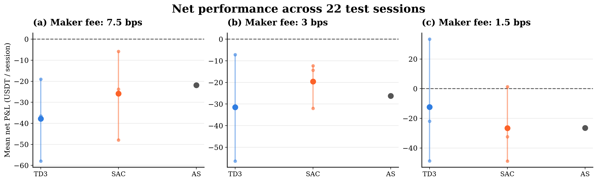
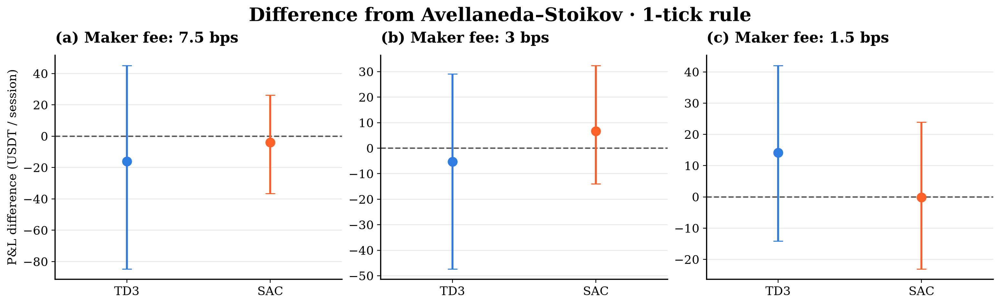
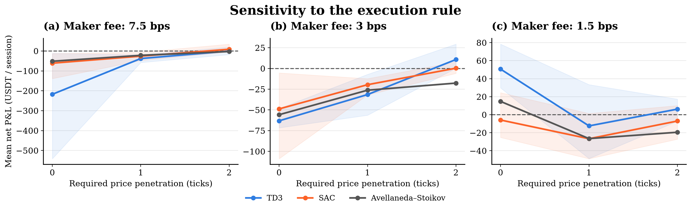

# Hawkes models and deep reinforcement learning for DOTUSDT market making

**[▶ Watch the experiment — Hawkes market making with TD3](docs/videos/HawkesMarketTD3-2.mp4)**

This study is a continuation of [Spread_Crypto](https://github.com/Maxime-Skryma/Spread_Crypto).

Can a learned quoting policy improve on a classical market maker once fees, inventory risk and execution assumptions are taken into account?

This experiment compares **TD3** (Twin Delayed DDPG) and **SAC** (Soft Actor–Critic) with **Avellaneda–Stoikov (AS)** on historical DOTUSDT sessions. Hawkes models describe clustered market events in the simulation framework; learned policies are subsequently fine-tuned and evaluated through historical replay. The focus is the transfer from training to observed markets, and how much the conclusions depend on trading costs and the fill rule.

## Experimental design

The study moves from synthetic training to historical fine-tuning, selects policies on 2024 validation sessions, and evaluates the retained policies on 22 later monthly sessions.

| Element | Protocol |
|---|---|
| Market | DOTUSDT |
| Earlier historical training period | Monthly sessions, January 2021–December 2023 |
| Validation | 12 monthly sessions in 2024; used for policy and checkpoint selection |
| Historical test | 22 sessions, January 2025–October 2026 |
| Session window | First day of each month, 00:10–23:59 UTC |
| Learned policies | TD3 and SAC, three training seeds each |
| Main comparison | Avellaneda–Stoikov; additional classical controls remain in the experiment outputs |
| Maker / taker fees | 7.5 / 7.5, 3 / 4.5, and 1.5 / 2.175 basis points |
| Primary execution rule | A fill requires one tick of price penetration; zero and two ticks are sensitivity checks |
| Outcome | Net P&L in USDT per observed session, after maker and taker fees |

One basis point is 0.01%. Policies are selected separately for each fee setting. Inventory is liquidated at the end of each session.

## What happened in the test?



**All three methods have negative mean net P&L under the primary one-tick rule.** SAC has the highest mean at 3 bps maker fees; TD3 has the highest mean at 1.5 bps. At 7.5 bps, AS performs best among these three methods. These are comparisons between separately selected policies, so the panels do not isolate the causal effect of fees.

| Maker fee | TD3 | SAC | AS |
|---|---:|---:|---:|
| 7.5 bps | −37.85 | −25.84 | −21.83 |
| 3 bps | −31.46 | −19.56 | −26.19 |
| 1.5 bps | −12.42 | −26.65 | −26.52 |

Values are mean net USDT per session, averaged across the three training seeds for TD3 and SAC. In the figure, large dots show means; small dots and vertical segments show individual seeds and their range. They are not confidence intervals. AS is deterministic within each fee setting. Panel scales differ.

## Is the improvement over AS consistent?



Positive differences favour the learned policy. TD3 at 1.5 bps improves on AS by about **14.10 USDT per session** on average; SAC at 3 bps improves by about **6.63 USDT**. However, every displayed interval crosses zero. The experiment therefore gives no clear evidence of a consistent advantage across these observed sessions.

Differences pair the same sessions after averaging the RL seeds. Error bars are the 2.5–97.5% quantiles of a circular bootstrap with two-session blocks and 10,000 draws. They are descriptive: they exclude training-seed sampling uncertainty and have no multiple-comparison adjustment.

## How much does the execution assumption matter?



Changing the fill rule changes both the level of P&L and some method rankings. Requiring deeper penetration can remove adverse fills as well as trading opportunities, so a stricter rule need not reduce P&L monotonically. Positive averages in some sensitivity settings should be read alongside the negative primary results.

The same selected policies and sessions are replayed under all three rules. Lines show means across seeds; shading shows the seed range. Panel scales differ. One tick remains the primary specification.

## What this experiment can tell us

The results suggest that execution modelling, transaction costs and training variability deserve as much attention as the learning algorithm. An improvement relative to AS can still correspond to a loss after fees.

### Limitations encountered

This remains an **exploratory study**, with several limitations:

- **Limited market data and temporal coverage.** The experiment covers one market and sampled monthly sessions, including only 22 test sessions. These are not consecutive trading days and cannot capture every intraday pattern, stressed period or liquidity condition. Trades and best bid/ask data also provide less information than a full order book with queue positions.
- **Changes in market regime.** Training, validation and test span different periods. Changes in volatility, liquidity and order-flow dynamics can weaken the transfer of a policy learned in an earlier period. The experiment does not establish robustness to these changes or explicitly model transitions between regimes.
- **A single pooled Hawkes calibration.** One set of Hawkes parameters is fitted jointly to the training sessions, representing their aggregate dynamics. This is a compromise describing an average market environment, rather than a separate fit for each regime or a continuous recalibration. Although Hawkes intensities react to recent events, fixed parameters cannot fully capture structural changes in order flow.
- **A gap between simulation and historical execution.** Synthetic training simplifies the market, and historical replay omits queue priority, trade-size limits and the impact of our own orders. Requiring price penetration only partially addresses optimistic fill assumptions; the sensitivity figures show that this choice materially affects the results.
- **Training variability and selection uncertainty.** Only three training seeds enter the final comparison, while validation searches over many candidates. Validation scores can therefore be optimistic, and the reported session-bootstrap intervals exclude training-seed sampling uncertainty and have no multiple-comparison adjustment.
- **Exceptions to the inventory guardrails.** TD3 seed 67 at 7.5 bps has no eligible candidate and uses the predefined fallback, whose validation mean absolute inventory is close to 10 lots against a threshold of 5. At 3 bps, TD3 seed 67 retains its starting policy. See the [figure and selection guide](resultats/README.md).
- **Limited evidence of economic profitability.** The main TD3, SAC and AS comparisons all have negative mean net P&L under the primary execution rule. Improving on a baseline in some fee settings does not establish a profitable or deployable trading strategy.

## Explore or reproduce the study

The three figures above are included so the findings can be read directly on GitHub. They are snapshots of the existing experiment, generated by [the plotting script](scripts/figures_finales.py). Raw market data, trained policies and full generated outputs remain local.

- [Reproduction procedure](docs/reproduction.md): data preparation, training, selection and historical replay.
- [Figure guide](resultats/README.md): definitions, uncertainty and additional plots.
- [Experiment commands](scripts/README.md) and [configurations](configs/README.md).

For installation and the numerical checks:

```sh
python -m pip install -r requirements-lock.txt
python -m pip install -e ".[notebook]"
python -m pytest tests -q
```

The full experiment requires downloading data and running the stages in the reproduction guide; installation alone does not recreate the results. Resource details are documented there.
